<div align="center">

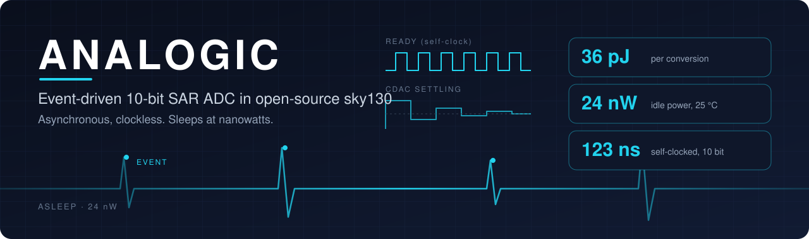

<br>


</div>

---

**This page has two parts:**

1. **[The ASIC](#the-product):** a 10-bit, 1 MS/s event-driven SAR ADC in sky130, complete layout, verified post-layout
2. **[Hardware proof](#part-2-hardware-proof):** the same SAR algorithm on a discrete 8-bit board driven by a Nexys A7 FPGA

---

# Part 1: the ASIC

## The product

ANALOGIC is a **10-bit, 1 MS/s, event-driven SAR ADC** in SkyWater sky130, taken from schematic to a complete, DRC/LVS-clean layout and verified **post-layout, at transistor level, across process corners and temperature**.

It **sleeps until something happens**, wakes on a single START pulse, runs the conversion on a **clock it generates itself**, then goes back to sleep. No clock tree. It fits any application where the signal is mostly quiet: neural recording, vibration monitoring, event-based imaging, sensor nodes.

<div align="center">
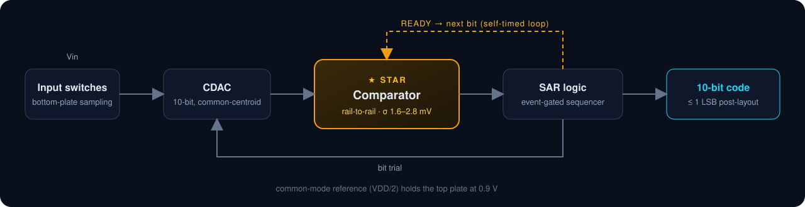
</div>

## What makes it different

| | |
|---|---|
| ⚡ **No clock at all** | The comparator times the whole conversion with its own **READY** pulse. No external clock, no internal oscillator, no clock tree: each bit takes exactly as long as the decision needs |
| 💤 **Event-driven** | One START pulse samples, converts and puts the ADC back to sleep. Between events there is nothing switching, an idle mode conventional SAR ADCs do not have |
| ↔️ **Rail-to-rail StrongARM comparator** | Works from 30 mV to 1.79 V common mode (and beyond both rails) with **σ 1.6–2.8 mV offset and no calibration**, where a classic StrongARM works around one fixed level |
| 🪞 **Replica CDAC** | A matched replica array sets the comparator's reference, so the comparator always decides near mid-supply and common-mode disturbances cancel instead of turning into error |
| 🛡️ **Shielded CDAC layout** | A grounded shield between bit lines and top plate keeps the 10-bit array linear: **DNL −0.20 LSB, INL 0.12 LSB** after extraction |
| ✋ **Clean STOP** | The SAR logic can freeze the self-timed loop instantly with zero fight current, so a conversion can be cut short safely |
| 🔬 **Verified like silicon is coming** | The complete ADC, analog core and synthesized logic, is DRC/LVS clean and simulated at transistor level with extracted parasitics at every corner: **within 1 LSB, 1 MS/s, 0.084 mm²** |
| 🔓 **Open PDK, open tools** | SkyWater sky130 and a fully open-source flow from schematic to GDS |

## Key specifications

All values are from **transistor-level simulation of the complete ADC with extracted layout parasitics** (sky130A, 1.8 V), unless noted.

| Parameter | Value |
|---|---|
| Resolution | 10 bit |
| Sample rate | **1 MS/s** at tt 25 °C, ss 75 °C and ff 25 °C |
| Conversion time (after sampling) | **191 ns** tt · 276–280 ns ss 75 °C · 141–143 ns ff |
| Accuracy, full RC-extracted ADC | Bottom, mid and top of range at all three corners: every code **within 1 LSB** |
| Input range | Rail-to-rail (tested 30 mV … 1.75 V) |
| Conversion energy, tt (10 bit decisions) | **94.5 pJ**: comparator 38.5, DAC drivers 34.5, SAR logic 21.5 |
| Idle | Event-driven sleep: no switching between events |
| Area | **316 x 267 µm = 0.084 mm²**, complete ADC |
| Physical verification | **DRC 0, LVS matched** for the complete ADC and every block |
| Clocking | None external: asynchronous comparator times every bit with its own READY pulse |

---

## The complete ADC, end to end

The whole converter is in one layout: signal CDAC, **replica CDAC**, bit drivers and input switches, common-mode generators, the asynchronous comparator **and the synthesized SAR logic**. It is RC-extracted and simulated at transistor level, from the START pulse to the final code.

<div align="center">
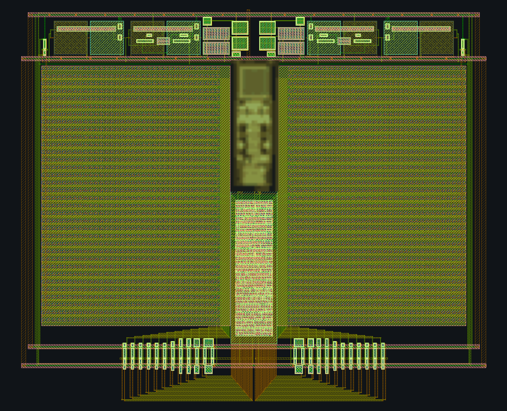
<br><sub><b>The complete ADC in sky130A, 316 x 267 µm:</b> signal and replica CDAC arrays, VCM generators across the top, drivers and switches below, synthesized SAR logic in the center column</sub>
</div>

<div align="center">
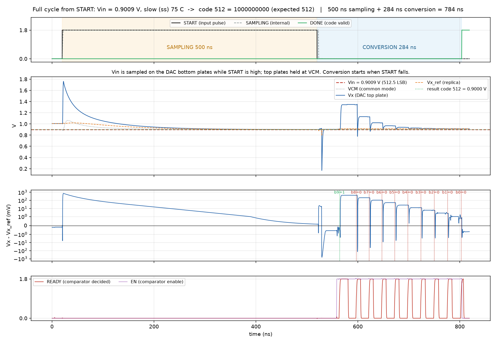
<br><sub><b>One full cycle from START at the slow corner (ss, 75 °C):</b> the input is sampled on the DAC bottom plates while START is high, then the comparator's own READY pulses walk through the 10 bits. Code 512, as expected</sub>
</div>

<div align="center">
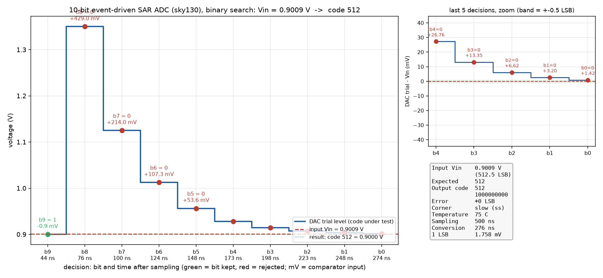
<br><sub><b>The binary search, bit by bit:</b> DAC trial level against the input, with the comparator input at every decision</sub>
</div>

<div align="center">
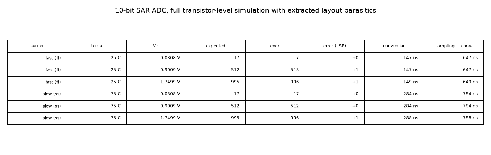
<br><sub><b>Corner results</b> on the extracted layout: tt, ss 75 °C, ff</sub>
</div>

---

## Power

Measured on the RC-extracted complete ADC (tt, 25 °C), each supply on its own pin.

| Supply pin | Block | Conversion energy (10 decisions) |
|---|---|---|
| VDDK | Comparator | **38.5 pJ** |
| VDD | DAC drivers and references | **34.5 pJ** |
| VDDD | SAR logic | **21.5 pJ** |
| | **Total, conversion phase** | **94.5 pJ** |

Sampling-phase energy and the full per-sample and idle figures are being characterized over back-to-back conversions and will be added here.

---

## Verification

Every number on this page comes from a test like the ones below. Nothing is quoted from schematic-only simulation unless it says so.

| Level | Test | Result |
|---|---|---|
| **Complete ADC** | DRC (Magic) | **0 errors** |
| | LVS (netgen), analog core + SAR logic | **Circuits match uniquely** |
| | Full conversion, RC-extracted, tt / ss 75 °C / ff × 3 input levels | **9 / 9 within 1 LSB** |
| | Sampling accuracy at end of 500 ns sampling | **≤ 0.15 mV** |
| | Throughput, worst corner | **780 ns per sample, 1 MS/s with margin** |
| | Supply power, per supply pin, extracted | see Power |
| | Connectivity check of every extracted netlist before simulation | **pass** |
| **SAR logic** | RTL simulation | **11 / 11 conversions correct** |
| | Gate-level, after synthesis and after place-and-route | **11 / 11 correct** |
| | Static timing | **met**, positive slack |
| | Place-and-route DRC, power connections, LVS | **0 violations, 0 errors, match** |
| **Comparator** | Monte Carlo offset, extracted layout | **σ 2.4 / 1.6 / 2.8 mV** at VCM 30 / 900 / 1790 mV |
| | Decisions on extracted layout, ±1 mV, all corners | **720 / 720 correct** |
| | STOP function, extracted layout | CLK held **< 0.58 mV**, decisions correct |
| | DRC / LVS | **clean / match** |
| **CDAC** | Static linearity, RC-extracted | **DNL −0.20 LSB, INL 0.12 LSB** |
| | Bit settling to 0.5 LSB, RC-extracted | **6.2 / 8.1 / 5.3 ns** (tt / ss 75 °C / ff) |
| | DRC (Magic + KLayout) / LVS | **0 / match** |
| **VCM generator** | 100 consecutive samples under 10-bit load | **no drift** |
| | Extracted vs schematic | **match** |
| | DRC / LVS | **0 / match** |
| **Switches** | On-resistance across corners, leakage at ff 75 °C | see System blocks |
| | DRC / LVS, layout vs schematic settling | **0 / match / equal** |

**Flow for every block:** schematic simulation (tt / ss / ff, 25 °C and 75 °C) → layout in Magic, mostly script-generated → DRC and LVS → parasitic extraction (R and C) → same testbench on the extracted netlist → Monte Carlo where matching matters → integration one level up.

---

## ★ The star: a rail-to-rail StrongARM comparator

<div align="center">
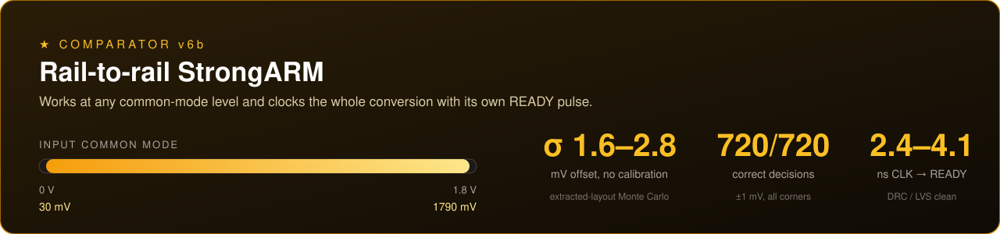
</div>

The comparator is the heart of an event-driven SAR, and it is **asynchronous**: there is no external clock. Once it has decided, it raises its own **READY** pulse, which re-arms it and clocks the next bit, so the conversion runs on a loop the comparator itself closes. It therefore had to work at any common-mode level and finish fast enough to drive that loop.

Most StrongARM comparators only work near one common-mode voltage. Ours works across the **entire supply range**, and in fact extends **beyond both rails**. We characterized it from 30 mV to 1.79 V in 1.8 V sky130 and did not sweep further, so every number below is for that window.

| Metric | Result |
|---|---|
| Input common mode | **Rail-to-rail and beyond.** Characterized: 30 … 1790 mV |
| Offset (extracted layout, Monte Carlo) | **σ 2.4 / 1.6 / 2.8 mV** at VCM 30 / 900 / 1790 mV, **no calibration** |
| Decision time (CLK → READY) | **4.1 / 3.0 / 2.4 ns** at VCM 30 / 900 / 1790 mV |
| Self-clocked loop (layout netlist, tt, 25 °C) | CLK → READY 3.7 / 2.9 / 2.3 ns, loop period 15.5 – 16.6 ns |
| Verification | **720 / 720** correct decisions on extracted layout (±1 mV, all corners) |
| Physical | **DRC clean, LVS matched**, 25.7 x 58.4 µm |

**STOP version:** the SAR logic can freeze the self-timed loop cleanly, with no fight current. Layout DRC 0, LVS matched. On the RC-extracted layout (tt): during STOP, CLK stays below **0.58 mV** and the cell draws **5.4 µA**, and decisions before and after STOP are correct.

---

## System blocks

### Capacitor DAC (CDAC)
Holds the sampled input and tries one bit per step: the SAR's balance.

| Metric | Result |
|---|---|
| Structure | 10-bit binary-weighted MIM array, 2D common-centroid, dummy ring, grounded shield between bit lines and top plate |
| Linearity (RC-extracted) | **DNL −0.20 LSB, INL 0.12 LSB** worst case |
| Bit settling to 0.5 LSB (RC-extracted) | **6.2 / 8.1 / 5.3 ns** (tt / ss 75 °C / ff), correct code at all corners |
| Layout | 128.6 x 177.3 µm, **DRC 0** (Magic + KLayout), **LVS matched** |

### Sampling and analog switches
Bottom-plate sampling through per-bit input switches, top plate held at VCM. Two transmission-gate cells, both with layout DRC 0, LVS matched and layout = schematic:

| Switch | Settling to 0.5 LSB (2 pF) | Peak Ron tt / ss / ff | Off leakage (worst) |
|---|---|---|---|
| Standard-Vt | 42.6 ns | 5.2k / 15.8k / 2.2k Ω | |
| **Low-Vt** | **13.6 ns** | **1.6k / 2.4k / 1.2k Ω** | **0.31 nA** (ff, 75 °C) |

### Common-mode reference (VDD/2)
Sets the comparison point.

| Metric | Result |
|---|---|
| Output | **0.900 V** (VDD/2, ratiometric to supply) |
| 10-bit sampling load | Always-on weak branch plus a strong branch that engages only during sampling. **No drift over 100 consecutive samples** |
| Layout | 24.7 x 49.9 µm, **DRC 0, LVS matched**, RC-extracted result matches the schematic |

### SAR logic and sequencer
Writes the bits, triggers and stops the comparator, generates its own timing.

| Metric | Result |
|---|---|
| Implementation | Verilog, synthesized and placed with sky130 standard cells, inside the ADC layout |
| Conversion | 10 bits from one START pulse, timed by the comparator's READY |
| Verification | RTL, gate-level and post-route gate-level: 11 / 11 conversions correct; timing met |

---

## How we compare

Our numbers are **post-layout simulation** of the complete ADC (sky130, 1.8 V, tt, 25 °C unless noted). Competitor numbers come from published work; names are withheld.

**SAR ADC**

| | **ANALOGIC (post-layout sim)** | A: open-source sky130 SAR | B: 180 nm SAR (silicon) |
|---|---|---|---|
| Technology / supply | sky130, 1.8 V | sky130, 1.8 V | 180 nm, 1.8 V |
| Resolution | 10 bit | 12 bit (non-binary) | 12 bit |
| Sample rate | **1 MS/s at every corner** | 1.44 MS/s | 2 MS/s |
| Idle (waiting for events) | **sleep mode, no switching** | runs continuously | runs continuously |
| Area | **0.084 mm²** | 0.175 mm² | 0.36 mm² |
| Clock | none, self-timed | external | external |

**Comparator**

| | **ANALOGIC (v6b, layout + MC)** | C: StrongARM (45 nm, sim) |
|---|---|---|
| Input range | **Rail-to-rail and beyond** (characterized VCM 30 … 1790 mV) | around a fixed VCM |
| Offset | **σ 1.6 – 2.8 mV** (Monte Carlo) | 28 mV |
| Decision time | 2.4 – 4.1 ns (CLK → READY) | 63 – 136 ps |
| Supply | 1.8 V | 1.2 V |

**In short:** the smallest area of the three, no clock to distribute, and an idle mode the others do not have. Competitor B is measured silicon; ours is post-layout simulation of the complete ADC, with ENOB verification next.

---

# Part 2: hardware proof

The SAR algorithm, the sample-and-hold sequence and the board-level control are proven on real hardware: a **discrete 8-bit R-2R SAR ADC board**, designed in KiCad, driven by a **Digilent Nexys A7-100T** (Artix-7) FPGA.

### The setup

```
  VIN ──► MCP6001 buffer ──► hold capacitor (10 nF) ──► MCP6561 comparator ◄── R-2R DAC (8 bit)
                ▲  SH                                           │ CMP              ▲ SEL1…SEL8
                └──────────── Nexys A7-100T (SAR controller, 7-segment, LEDs) ◄────┘
```

| Block | Implementation |
|---|---|
| DAC | 8-bit R-2R ladder, 100 kΩ ±0.5 % 25 ppm thin film (R = two 100 k in parallel) |
| Bit switches | 74HC4053 analog multiplexers, each bit switched between VREF and GND |
| Sample and hold | MCP6001 rail-to-rail buffer, 10 nF film hold capacitor, mux channel as switch |
| Comparator | MCP6561 rail-to-rail comparator |
| Reference / range | Nexys 3.3 V rail, 0 … 3.3 V, 1 LSB = 12.9 mV |
| Controller | Verilog SAR state machine on the Nexys A7, majority vote on every bit decision |
| User interface | 7-segment shows code and voltage, LEDs show code, comparator and state; single-shot, continuous 10 Hz and manual-DAC modes |

### The board

<table>
<tr>
<td align="center" width="50%">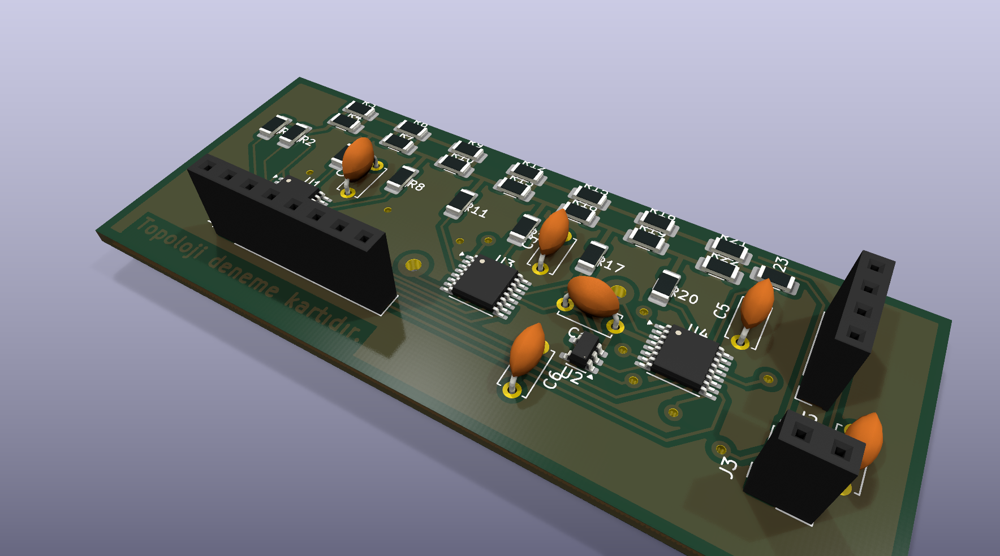<br><sub><b>KiCad 3D view</b></sub></td>
<td align="center" width="50%">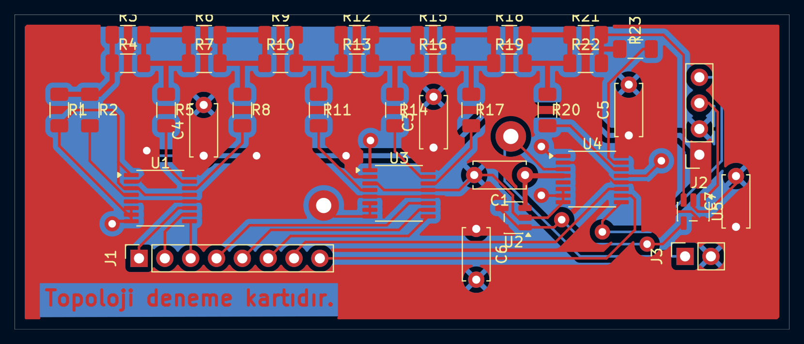<br><sub><b>PCB layout</b>, top and bottom copper, two layers with ground pour</sub></td>
</tr>
</table>

<div align="center">
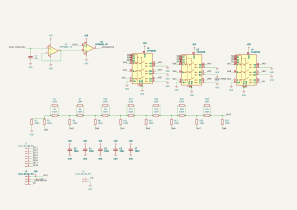
<br><sub><b>Schematic:</b> buffer and hold capacitor, comparator, three 4053 switch banks, R-2R ladder, FPGA headers</sub>
</div>

### FPGA controller verification

The controller is simulated against a behavioural model of the board, including the board's real bit order and switch polarity taken from the KiCad netlist.

| Test | Result |
|---|---|
| Testbench, board model in the loop | **14 / 14 tests passed, 0 errors** |
| Full transfer sweep, 0 … 3.3 V | **1101 points, 0 code errors** |
| Codes across the range | 0 mV → 0, 13 mV → 1, 1.000 V → 77, 1.650 V → 128, 2.222 V → 172, 3.300 V → 255: **all exact** |
| Continuous mode and manual-DAC mode | **pass** |
| Timing at 100 MHz (Vivado) | **met, WNS +3.73 ns, WHS +0.12 ns** |
| FPGA resources | **188 LUTs, 243 flip-flops, 1 DSP** (0.3 % of the Artix-7 100T) |
| Conversion time | 100 µs sampling + 8 × 20 µs bits ≈ 262 µs |

<div align="center">
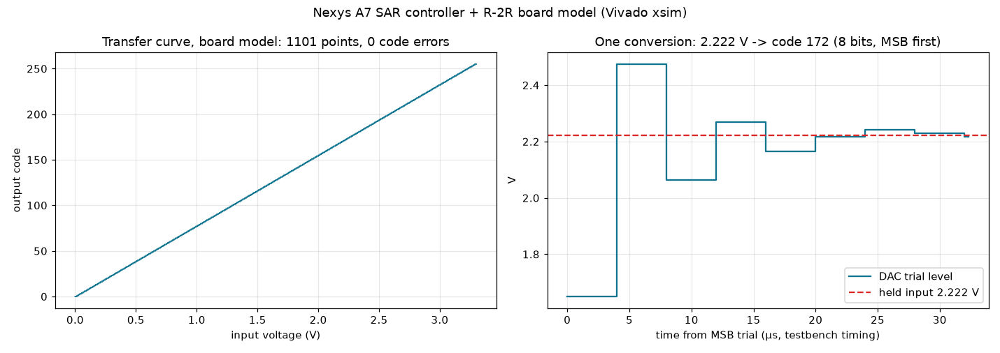
<br><sub><b>Controller + board model:</b> full transfer curve with no code errors, and one conversion stepping onto 2.222 V</sub>
</div>

### Bring-up

Board assembly and bench bring-up: **coming**.

| Measurement | Status |
|---|---|
| Oscilloscope: sample-and-hold, bit-by-bit DAC steps, comparator output | coming |
| Measured transfer curve and DNL / INL from a code histogram | coming |

---

## Roadmap

- [x] Rail-to-rail asynchronous StrongARM comparator: layout, DRC/LVS, Monte Carlo
- [x] Shielded 10-bit CDAC, switches and common-mode reference: layout, DRC/LVS, RC-extracted verification
- [x] Comparator with STOP input
- [x] SAR logic: RTL, synthesis, place-and-route, gate-level verification
- [x] Complete ADC layout: DRC 0, LVS matched, 0.084 mm²
- [x] Transistor-level conversions on the extracted ADC: within 1 LSB, 1 MS/s at every corner
- [x] Post-layout conversion energy per supply
- [ ] Full per-sample and idle power over back-to-back conversions
- [ ] ENOB verification by FFT
- [x] Hardware proof: 8-bit R-2R SAR board (KiCad) and Nexys A7 controller, 14 / 14 testbench tests, timing met
- [ ] Hardware proof: bench bring-up and oscilloscope captures
- [ ] Pixel/channel-level event detection integration

## Tools

**ASIC:** SkyWater **sky130A** · xschem · ngspice · Magic · netgen · KLayout · Yosys · OpenROAD · IIC-OSIC-TOOLS<br>
**Hardware:** KiCad · Vivado · Digilent Nexys A7-100T

---

<div align="center"><sub>Design files are not open source. Get in touch for collaboration.</sub></div>
