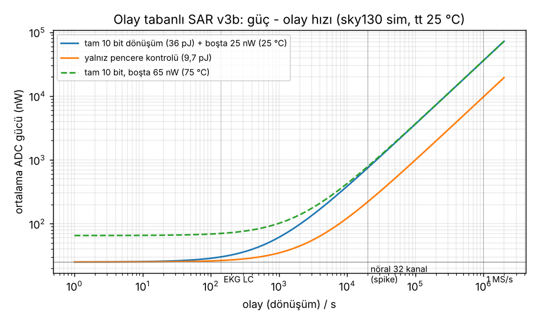
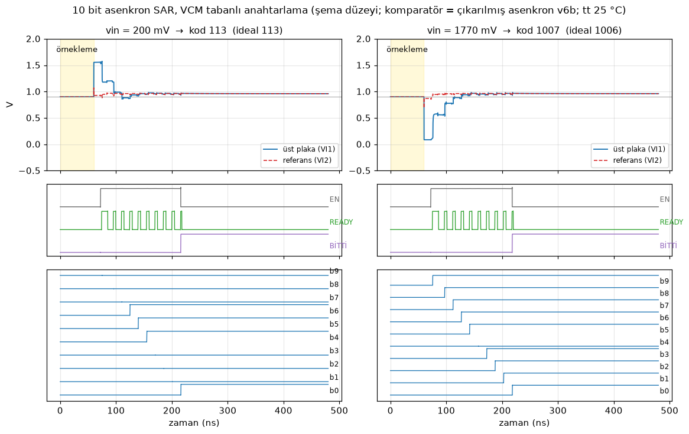

# ⚡ ANALOGIC

### Olay tabanlı 10 bit SAR ADC · sky130 · uyurken nanowatt, uyanınca 36 pJ

---

## 🎯 Ne yapıyoruz?

Sinyal değişmediği sürece **uyuyan**, bir olay gelince kendini uyandırıp dönüşümü **kendi saatini üreterek** yapan, sonra tekrar uykuya dönen bir **10 bit SAR ADC**. Saat ağacı yok, boşta neredeyse sıfır güç.

**Neden önemli?** Sinir sinyali kaydı, titreşim izleme, olay tabanlı görüntüleme gibi uygulamalarda sinyal çoğu zaman sessizdir. Klasik ADC sessizlikte de durmadan örnekler ve güç yakar; bizimki sadece iş olduğunda çalışır.

## 🏆 Öne çıkanlar

| | |
|---|---|
| ⚡ **Dönüşüm başı enerji** | **36 pJ** (aynı PDK'daki açık kaynak rakipten ~13 kat düşük) |
| 😴 **Boşta güç** | **24 nW** (25 °C), 65 nW (75 °C) |
| 🎚️ **Rail-to-rail komparatör** | Giriş ortak modu 30 mV … 1790 mV, kalibrasyonsuz ofset **σ 1,6 – 2,8 mV** |
| ✅ **Doğruluk** | 30 … 1770 mV aralığında, tt/ss/ff köşelerinde ve 75 °C'de **−1 … 0 LSB** |
| 🧩 **Kendi saatini üretir** | Tek START darbesiyle 10 biti asenkron çözer, 123 ns |
| 🪟 **Akıllı modlar** | Erken durma (6 bit, 26 pJ), tek kararlık pencere kontrolü (9,7 pJ) |
| 🧪 **Layout'a kadar** | Komparatör çizildi, DRC/LVS temiz, çıkarılmış layout üzerinde Monte Carlo |

 <b>Ortalama güç olay hızıyla ölçekleniyor:</b> saniyede birkaç olayda ADC 25 nW civarında kalıyor

 <b>Asenkron 10 bit dönüşüm:</b> her READY darbesi bir bit

## 🧱 Sistemin parçaları

Her blok önce tek başına doğrulandı, sonra bir üst seviyeye eklendi. (Tasarım detayları paylaşılmıyor, sadece ne yaptıkları ve sonuçları.)

| Blok | Görevi | Sonuç |
|---|---|---|
| **Komparatör** | Kapasite dizisinin çıkışını referansla karşılaştırır, kararı verince READY üretir | Rail-to-rail (30 … 1790 mV), ofset σ 1,6 – 2,8 mV, karar 2,4 – 4,1 ns, layout + DRC/LVS temiz |
| **CDAC (kapasite DAC'ı)** | Örneklenen girişi tutar, her adımda bir biti dener | 9 bit + dummy dizisi el ile sürülen SAR testinde doğru kodu veriyor; hata **< 0,1 LSB**, en kötü bit oturması **24 ns** |
| **Örnekleme anahtarı** | Girişi kapasitelere alır | Direnci giriş geriliminden bağımsız (bootstrap), raydan raya giriş |
| **Analog anahtarlar** | Kapasite plakalarını referanslara bağlar | 2 pF yükte 10 bit yarım-LSB'ye 43 ns'de oturma |
| **Ortak mod referansı (VDD/2)** | Karşılaştırma noktasını üretir | 0,900 V, ~20 nA; örnekleme anında sadece 20 µV çökme |
| **SAR mantığı + sıralayıcı** | Bitleri yazar, komparatörü tetikler ve durdurur | Tek START ile 10 bit, 123 ns; erken durma, pencere kontrolü ve zaman aşımı koruması |

## 🏁 Literatürde neredeyiz?

Bizim sayılar **simülasyon** (sky130, 1,8 V, tt, 25 °C; komparatör sayıları çıkarılmış layout'tan). Rakip sayıları yayınlanmış çalışmalardan alındı, isim verilmedi.

**SAR ADC**

| | **Biz (SAR v3, sim)** | Rakip A: açık kaynak sky130 SAR | Rakip B: 180 nm SAR (silikon) |
|---|---|---|---|
| Teknoloji / besleme | sky130, 1,8 V | sky130, 1,8 V | 180 nm, 1,8 V |
| Çözünürlük | 10 bit | 12 bit (ikili olmayan) | 12 bit |
| Örnekleme hızı | 1 MS/s (dönüşüm 123 ns) | 1,44 MS/s | 2 MS/s |
| Güç (tam hızda) | **36 µW** | 703 µW | 183 µW |
| Dönüşüm başı enerji | **36 pJ** | ~488 pJ | ~92 pJ |
| Walden FoM | ~43 fJ/adım (ENOB 9,7 varsayımı) | yayında yok | 48,6 fJ/adım (ölçülmüş) |
| Boşta güç (olay beklerken) | **24 nW** (75 °C'de 65 nW) | sürekli çalışıyor | sürekli çalışıyor |
| Alan | henüz yok | 0,175 mm² | 0,36 mm² |

**Komparatör**

| | **Biz (v6b, layout + MC)** | Rakip C: StrongARM (45 nm, sim) |
|---|---|---|
| Giriş aralığı | **Rail-to-rail** (VCM 30 … 1790 mV) | sabit VCM civarı |
| Ofset | **σ 1,6 – 2,8 mV** (Monte Carlo) | 28 mV |
| Karar süresi | 2,4 – 4,1 ns (CLK → READY) | 63 – 136 ps |
| Besleme | 1,8 V | 1,2 V |

**Kısaca:** olay tabanlı çalışma sayesinde boşta rakiplerin binde biri kadar güç, dönüşüm başına da çok daha az enerji. Rakip B silikonda ölçülmüş bir çip; bizim sayılarımız henüz simülasyon, ENOB doğrulaması ve tam sistem layout'u yolda.

## 🗺️ Yol haritası

- [x] Rail-to-rail StrongARM komparatör: layout, DRC/LVS, Monte Carlo
- [x] Olay tabanlı 10 bit SAR referans tasarımı: 36 pJ, boşta 24 nW
- [x] CDAC, örnekleme anahtarları ve ortak mod referansı blok blok doğrulandı
- [ ] Tüm sistemi hiyerarşik şemada birleştirmek
- [ ] FFT ile ENOB doğrulaması
- [ ] Tam ADC layout'u ve FPGA (Nexys A7) üzerinde SAR mantığı denemesi
- [ ] Piksel/kanal seviyesinde olay algılama entegrasyonu

## 🛠️ Araçlar

SkyWater **sky130A** · xschem · ngspice · magic · netgen · IIC-OSIC-TOOLS

---

Tasarım dosyaları şimdilik açık kaynak değil. İş birliği için iletişime geçebilirsiniz.

